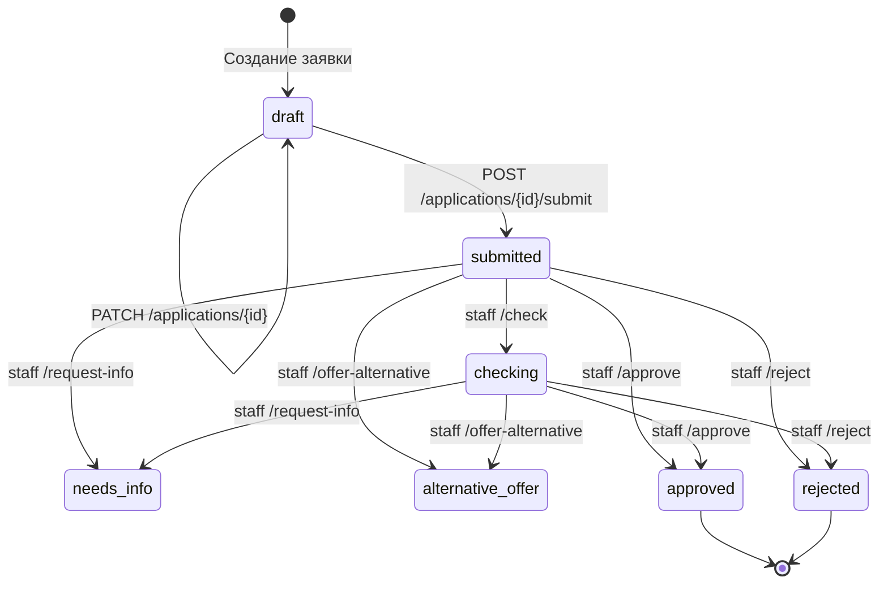

# Состояния кредитной заявки — Smart Credit Cabinet

## 1. Состояния

| Статус | Описание | Тип |
|---|---|---|
| `draft` | Черновик; пользователь может редактировать | Промежуточный |
| `submitted` | Отправлена на рассмотрение | Промежуточный |
| `checking` | Сотрудник начал проверку | Промежуточный |
| `needs_info` | Запрошены дополнительные сведения | Промежуточный |
| `alternative_offer` | Предложены альтернативные условия | Промежуточный |
| `approved` | Одобрена сотрудником | Финальный |
| `rejected` | Отклонена сотрудником | Финальный |

## 2. Диаграмма переходов

 develop/backend-db
## 3. История статусов

При создании и изменении статуса backend записывает событие в `application_history`: прежний статус, новый статус, комментарий и время события.

## 4. Ограничения реализации

Переход `needs_info` → `submitted` (повторная отправка после предоставления информации) обозначен в старом проектном описании как TODO. Он не включён в диаграмму реализованных переходов. Поведение `alternative_offer` после согласия пользователя также требует отдельного сценария и не считается реализованным без подтверждения исходным кодом.

## 3. Кто меняет статус

| Переход | Кто | Эндпоинт |
|---|---|---|
| `[создание] → draft` | Пользователь | `POST /applications` |
| `draft → submitted` | Пользователь | `POST /applications/{id}/submit` |
| `submitted → checking` | Staff | `POST /applications/{id}/check` |
| `submitted/checking → needs_info` | Staff | `POST /applications/{id}/request-info` |
| `submitted/checking → alternative_offer` | Staff | `POST /applications/{id}/offer-alternative` |
| `submitted → approved` | Staff | `POST /applications/{id}/approve` |
| `submitted → rejected` | Staff | `POST /applications/{id}/reject` |

Пользователь не может менять статус напрямую, кроме `draft → submitted` через `/submit`.

## 4. Что происходит при submit

1. Проверка статуса `draft`.
2. Проверка продукта (активен, сумма и срок в лимитах).
3. Расчёт `monthly_payment`, `total_payment`, `overpayment`.
4. Установка `preliminary_result`:
   - `likely_eligible` — платёж ≤ 40% дохода;
   - `high_debt_burden` — платёж > 40% дохода.
5. Статус → `submitted`, запись в `application_history`.

## 5. История статусов

Каждый переход пишется в `application_history`: `old_status`, `new_status`, `comment`, `created_at`.

Просмотр: `GET /applications/{id}/history` (только владелец).

## 6. Ошибки

| Код | Когда |
|---|---|
| `404` | Заявка не существует или принадлежит другому |
| `401` | Нет токена |
| `403` | Нет роли `staff`/`admin` |
| `409` | Неподходящий текущий статус |
| `422` | Ошибка валидации |

## 7. Пример сценария

1. Пользователь создаёт заявку → `draft`.
2. Редактирует → `draft`.
3. Submit → `submitted`, `preliminary_result=likely_eligible`.
4. Staff `/check` → `checking`.
5. Staff `/approve` → `approved`.
6. Пользователь `GET /history`:
   - `null → draft`
   - `draft → submitted`
   - `submitted → checking`
   - `checking → approved`

## 8. Ограничения реализации

Переход `needs_info → submitted` (повторная отправка после предоставления информации) — **не реализован**, помечен как TODO. Поведение `alternative_offer → draft` после согласия пользователя — **не реализовано**, требует отдельного сценария.
 main
