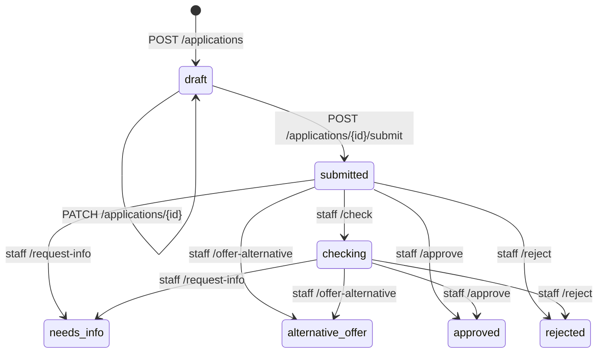

# Состояния кредитной заявки

## Статусы

| Статус | Значение | Реализованное действие |
|---|---|---|
| `draft` | Черновик | Владелец может редактировать и отправить заявку |
| `submitted` | Отправлена на рассмотрение | Сотрудник может начать проверку, запросить сведения, предложить альтернативу или принять решение |
| `checking` | Проверяется сотрудником | Сотрудник может запросить сведения, предложить альтернативу или принять решение |
| `needs_info` | Запрошены дополнительные сведения | Возврат к редактированию или повторная отправка не реализованы |
| `alternative_offer` | Предложены альтернативные условия | Принятие или отклонение предложения не реализовано |
| `approved` | Одобрена сотрудником | Финальное решение в текущем процессе |
| `rejected` | Отклонена сотрудником | Финальное решение в текущем процессе |

Статусы хранятся как строки; отдельный enum и проверки переходов на уровне БД не используются.

## Реализованные переходы

Переходы из `needs_info`, `alternative_offer`, `approved` и `rejected` в текущих API-обработчиках не реализованы. В частности, после запроса дополнительных сведений заявку нельзя изменить или повторно отправить через текущий API. Согласие пользователя с альтернативными условиями также не обрабатывается. Поэтому `needs_info` и `alternative_offer` не являются финальными решениями, но в текущей реализации не имеют дальнейшего перехода.

## Условия переходов

### Создание и отправка

`POST /applications` создаёт заявку в статусе `draft`. Перед этим backend проверяет доступность продукта и диапазоны суммы/срока, наличие профиля бизнеса и заполненную месячную выручку. Выручка профиля копируется в `monthly_income` заявки. Создание также записывает событие `NULL → draft` в историю.

`PATCH /applications/{id}` доступен только владельцу и только пока статус — `draft`.

`POST /applications/{id}/submit` также доступен только владельцу и только для `draft`. Backend повторно проверяет продукт и его лимиты, рассчитывает платежи и устанавливает `preliminary_result`:

- `likely_eligible`, если ежемесячный платёж не превышает 40% `monthly_income`;
- `high_debt_burden`, если платёж превышает 40%.

Затем заявка переходит в `submitted`, и переход записывается в историю. Предварительная оценка не является решением банка.

### Обработка сотрудником

Операции сотрудников требуют роль `staff` или `admin`.

| Действие | Допустимый исходный статус | Новый статус |
|---|---|---|
| `POST /applications/{id}/check` | `submitted` | `checking` |
| `POST /applications/{id}/request-info` | `submitted`, `checking` | `needs_info` |
| `POST /applications/{id}/offer-alternative` | `submitted`, `checking` | `alternative_offer` |
| `POST /applications/{id}/approve` | `submitted`, `checking` | `approved` |
| `POST /applications/{id}/reject` | `submitted`, `checking` | `rejected` |

Отклонение дополнительно сохраняет причину в `decision_comment` и истории статусов.

## История и доступ

При создании заявки и каждом переходе статуса backend создаёт запись в `application_history` с прежним и новым статусом, комментарием и временем. Эндпоинт истории возвращает записи в порядке убывания `created_at`.

Клиентские операции над заявками ограничены заявками текущего пользователя. Роль `staff`/`admin` может просматривать заявки и историю. Попытка изменить заявку не в `draft` или выполнить недопустимый переход возвращает `409 Conflict`; отсутствие или недоступность заявки для пользователя обычно возвращает `404 Not Found`.
