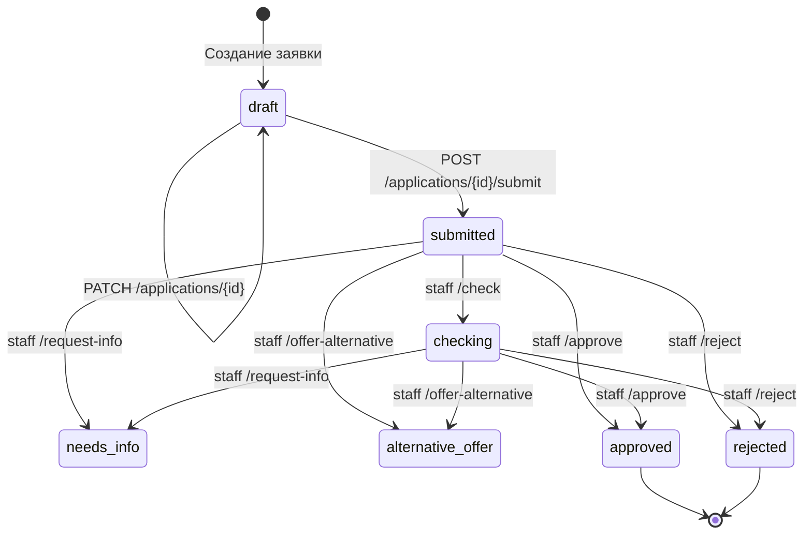

# Состояния кредитной заявки — Smart Credit Cabinet

## 1. Состояния

| Статус | Описание | Тип |
|---|---|---|
| `draft` | Черновик; пользователь может редактировать | Промежуточный |
| `submitted` | Отправлена на рассмотрение | Промежуточный |
| `checking` | Сотрудник начал проверку | Промежуточный |
| `needs_info` | Запрошены дополнительные сведения | Промежуточный |
| `alternative_offer` | Предложены альтернативные условия | Промежуточный |
| `approved` | Одобрена сотрудником | Финальный |
| `rejected` | Отклонена сотрудником | Финальный |

## 2. Диаграмма переходов

## 3. История статусов

При создании и изменении статуса backend записывает событие в `application_history`: прежний статус, новый статус, комментарий и время события.

## 4. Ограничения реализации

Переход `needs_info` → `submitted` (повторная отправка после предоставления информации) обозначен в старом проектном описании как TODO. Он не включён в диаграмму реализованных переходов. Поведение `alternative_offer` после согласия пользователя также требует отдельного сценария и не считается реализованным без подтверждения исходным кодом.
