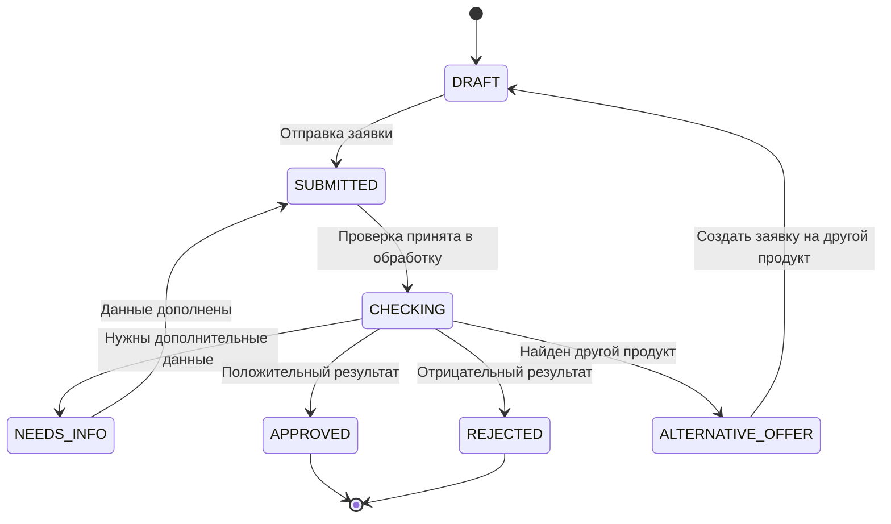

# Состояния кредитной заявки — Smart Credit Cabinet

## 1. Назначение

Документ описывает жизненный цикл кредитной заявки: от создания черновика предпринимателем до завершения демонстрационной обработки.

Управление состояниями выполняется на стороне backend. Frontend отображает текущий статус и доступные пользователю действия, но не изменяет статус напрямую.

## 2. Перечень состояний

| Статус | Название | Описание |
|---|---|---|
| `DRAFT` | Черновик | Заявка создана, но ещё не отправлена. Пользователь может редактировать данные. |
| `SUBMITTED` | Отправлена | Пользователь отправил заявку. Сервер проверил наличие обязательных полей. |
| `CHECKING` | Проверяется | Система выполняет демонстрационные проверки заявки. |
| `NEEDS_INFO` | Требуется информация | Для продолжения обработки необходимо дополнить или исправить данные. |
| `APPROVED` | Одобрена | Демонстрационная оценка завершилась положительным результатом. |
| `REJECTED` | Отклонена | Демонстрационная оценка завершилась отрицательным результатом. |
| `ALTERNATIVE_OFFER` | Альтернативное предложение | Система обнаружила другой кредитный продукт, который может лучше соответствовать параметрам пользователя. |

Статусы `APPROVED` и `REJECTED` отражают только результат демонстрационного алгоритма и не являются решением реального банка.

## 3. Диаграмма переходов

Переход из `ALTERNATIVE_OFFER` в `DRAFT` предполагает создание новой заявки или нового черновика на выбранный продукт. Не следует автоматически изменять продукт уже отправленной заявки.

## 4. Правила переходов

### 4.1. Создание черновика

**Переход:** `DRAFT` → `DRAFT`

При создании заявки сервер:
- проверяет авторизацию пользователя;
- проверяет существование и доступность выбранного кредитного продукта;
- проверяет корректность суммы и срока;
- сохраняет заявку со статусом `DRAFT`;
- записывает событие создания в историю заявки.

### 4.2. Отправка заявки

**Переход:** `DRAFT` → `SUBMITTED`

При отправке сервер:
- проверяет, что заявка принадлежит текущему пользователю;
- проверяет обязательные поля;
- проверяет допустимость суммы и срока;
- фиксирует дату отправки;
- сохраняет новый статус и запись истории.

Если данные некорректны, сервер возвращает ошибку валидации. Заявка остаётся в статусе `DRAFT`.

### 4.3. Начало проверки

**Переход:** `SUBMITTED` → `CHECKING`

Система принимает заявку в обработку и запускает демонстрационные проверки. При необходимости могут проверяться полнота профиля бизнеса, соответствие параметров условиям продукта и наличие подходящих альтернатив.

### 4.4. Запрос дополнительной информации

**Переход:** `CHECKING` → `NEEDS_INFO`

Если необходимых сведений недостаточно, заявка переводится в `NEEDS_INFO`.

Система сохраняет причину запроса. Пользователь получает возможность дополнить необходимые сведения.

**Переход:** `NEEDS_INFO` → `SUBMITTED`

После дополнения данных заявка повторно отправляется на обработку. Backend повторно проверяет обязательные поля и возвращает заявку в очередь обработки.

В MVP список запрашиваемых сведений можно хранить в комментарии или отдельном поле результата проверки.

### 4.5. Положительный результат

**Переход:** `CHECKING` → `APPROVED`

Демонстрационный алгоритм завершает оценку положительно. Сервер сохраняет результат и пояснение, после чего отображает их в личном кабинете.

### 4.6. Отрицательный результат

**Переход:** `CHECKING` → `REJECTED`

Алгоритм завершает оценку отрицательно. Система сохраняет причину результата и показывает её пользователю, если она предусмотрена логикой MVP.

### 4.7. Альтернативное предложение

**Переход:** `CHECKING` → `ALTERNATIVE_OFFER`

Если исходные параметры не соответствуют выбранному продукту, но найден другой подходящий продукт, система может предложить альтернативу.

Пользователь может просмотреть условия альтернативного продукта и при согласии создать новую заявку.

## 5. Разрешённые действия пользователя

| Действие | Разрешённые состояния | Результат |
|---|---|---|
| Просмотреть заявку | Все состояния | Возвращаются данные заявки и статус |
| Редактировать параметры заявки | `DRAFT` | Изменяются разрешённые поля |
| Отправить заявку | `DRAFT` | Переход в `SUBMITTED` |
| Дополнить запрошенные сведения | `NEEDS_INFO` | Данные сохраняются для повторной отправки |
| Просмотреть результат | `APPROVED`, `REJECTED`, `ALTERNATIVE_OFFER` | Отображаются результат и пояснения |
| Оформить альтернативное предложение | `ALTERNATIVE_OFFER` | Создаётся новый черновик |

Все действия выполняются только владельцем заявки. Изменение статусов выполняется сервером в соответствии с бизнес-правилами.

## 6. API и состояния

Для управления заявками используются следующие эндпоинты:

| Метод | Эндпоинт | Назначение |
|---|---|---|
| `POST` | `/api/v1/applications` | Создать черновик |
| `PATCH` | `/api/v1/applications/{id}` | Изменить черновик |
| `POST` | `/api/v1/applications/{id}/submit` | Отправить заявку |
| `GET` | `/api/v1/applications` | Получить список заявок |
| `GET` | `/api/v1/applications/{id}` | Получить детали заявки |
| `GET` | `/api/v1/applications/{id}/decision` | Получить результат демонстрационной оценки |
| `GET` | `/api/v1/applications/{id}/history` | Получить историю изменений |

Отдельный публичный эндпоинт для изменения статуса не предусматривается. Клиент не должен отправлять произвольное значение `status` при редактировании заявки.

## 7. Хранение истории

Каждое изменение статуса фиксируется в таблице `ApplicationHistory`.

Для каждого события сохраняются:
- идентификатор заявки;
- предыдущий статус;
- новый статус;
- комментарий или причина изменения;
- дата и время события.

Создание заявки также рекомендуется отражать в истории. Запись истории и изменение текущего статуса должны выполняться согласованно в рамках одной транзакции базы данных.

## 8. Ошибки и ограничения

Backend должен обрабатывать следующие ситуации:

- `404 Not Found` — заявка не существует либо недоступна текущему пользователю;
- `401 Unauthorized` — пользователь не авторизован;
- `403 Forbidden` — действие запрещено правилами доступа;
- `409 Conflict` — действие несовместимо с текущим статусом;
- `422 Unprocessable Entity` — данные не прошли валидацию.

Для защиты данных система проверяет владельца заявки при каждом запросе. Статус нельзя менять простым редактированием запроса со стороны frontend.

## 9. Особенности MVP

В рамках MVP обработка заявки и принятие решения имитируются внутренней бизнес-логикой. Интеграции с банковскими системами, кредитными бюро и государственными сервисами не предполагаются.

Автоматический подбор кредитных продуктов выполняется отдельно от жизненного цикла заявки. Результат подбора помогает пользователю выбрать продукт, а создание заявки запускает отдельный процесс обработки.

В дальнейшем модель может быть расширена статусами, связанными с внешними проверками, запросом документов, ожиданием ответа банка и фактическим заключением договора.