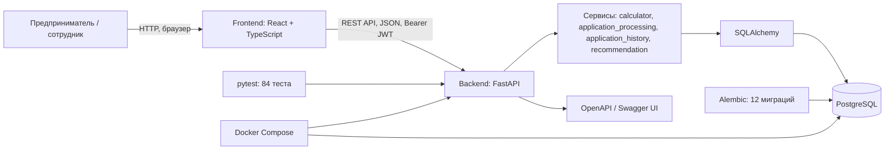

# Архитектура системы «Умный кредитный кабинет предпринимателя»

## 1. Назначение

«Умный кредитный кабинет предпринимателя» — веб-приложение для подбора кредитных предложений и подачи заявок на кредитование малого бизнеса. Пользователь регистрируется, заполняет профиль бизнеса, сравнивает предложения, создаёт и отправляет заявку. Сотрудник банка рассматривает заявку и принимает демонстрационное решение.

MVP не использует реальные банковские или государственные интеграции. Данные о продуктах и результат обработки являются демонстрационными.

## 2. Технологический стек

| Компонент | Технология | Назначение |
|---|---|---|
| Frontend | React, TypeScript, Vite | Пользовательский интерфейс (в разработке) |
| Backend | Python 3.13, FastAPI | REST API и бизнес-логика |
| Валидация | Pydantic v2 | Схемы запросов и ответов |
| БД | PostgreSQL | Хранение данных |
| ORM | SQLAlchemy 2.x | Доступ к данным |
| Миграции | Alembic | Управление схемой БД |
| Аутентификация | JWT (PyJWT), Argon2 (pwdlib) | Токены, хеширование паролей |
| Тесты | pytest (84 теста) | Автоматическая проверка |
| API-документация | OpenAPI, Swagger UI | `/docs`, `/openapi.json` |
| Запуск | Docker, Docker Compose | Воспроизводимый запуск |

## 3. Архитектурная схема



## 4. Основные сценарии

1. Пользователь регистрируется и входит (JWT).
2. Просматривает продукты и рассчитывает платёж (`/calculator/calculate`, `/calculator/compare`).
3. Заполняет профиль бизнеса (`PUT /business-profile`).
4. Запрашивает рекомендации (`POST /recommendations`).
5. Создаёт черновик заявки (`POST /applications`), редактирует (`PATCH`), отправляет (`/submit`).
6. Backend считает платежи, ставит `preliminary_result`, пишет историю, ставит `submitted`.
7. Staff переводит в `checking`/`needs_info`/`alternative_offer`/`approved`/`rejected`.
8. Пользователь видит свою заявку и историю (`GET /applications/{id}/history`).

## 5. Безопасность

- Все защищённые эндпоинты требуют `Authorization: Bearer <token>`.
- Пароли — Argon2, не открытым текстом.
- Пользователь видит только свои заявки, профиль, подборы.
- Staff-эндпоинты требуют роль `staff`/`admin` (проверка на backend).
- `preliminary_result` — не банковское решение.
- Реальных платежей нет.

## 6. Структура backend (актуальная)

```text
backend/
├── app/
│   ├── api/
│   │   ├── auth.py
│   │   ├── applications.py
│   │   ├── products.py
│   │   ├── calculator.py
│   │   ├── business_profile.py
│   │   └── recommendations.py
│   ├── core/
│   │   ├── config.py
│   │   ├── database.py
│   │   ├── json_type.py
│   │   └── security.py
│   ├── models/
│   │   ├── user.py
│   │   ├── credit_application.py
│   │   ├── credit_product.py
│   │   ├── application_history.py
│   │   ├── business_profile.py
│   │   └── recommendation.py
│   ├── schemas/
│   │   ├── auth.py
│   │   ├── credit_application.py
│   │   ├── credit_product.py
│   │   ├── calculator.py
│   │   ├── application_history.py
│   │   ├── application_decision.py
│   │   ├── business_profile.py
│   │   └── recommendation.py
│   ├── services/
│   │   ├── auth.py
│   │   ├── calculator.py
│   │   ├── application_processing.py
│   │   ├── application_history.py
│   │   └── recommendation.py
│   └── main.py
├── alembic/
│   └── versions/     # 12 миграций
├── scripts/
│   └── seed_products.py
├── tests/            # 84 теста
├── Dockerfile
├── .dockerignore
├── alembic.ini
└── requirements.txt
```

## 7. API и запуск

Префикс API: `/api/v1`. После запуска backend:
- Swagger UI: `http://127.0.0.1:8000/docs`
- OpenAPI JSON: `http://127.0.0.1:8000/openapi.json`

### Docker (рекомендуется)

```powershell
docker compose up --build
```

Backend автоматически применяет миграции и заливает демо-продукты.

### Локально

```powershell
cd backend
.\.venv\Scripts\python.exe -m alembic upgrade head
.\.venv\Scripts\python.exe -m scripts.seed_products
.\.venv\Scripts\python.exe -m uvicorn app.main:app --reload
```

Подробности — в `README-setup.md`.

## 8. Тестирование

84 теста (`pytest -v`), SQLite in-memory с `StaticPool`, `JSONType` (JSONB для Postgres / JSON для SQLite). Покрыто: auth, applications, processing, history, statuses, business profile, recommendations, calculator, products, security.
