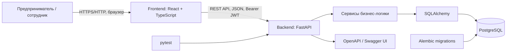

# Архитектура системы «Умный кредитный кабинет предпринимателя»

## 1. Назначение

«Умный кредитный кабинет предпринимателя» — веб-приложение для подбора кредитных предложений и подачи заявок на кредитование малого бизнеса. Пользователь регистрируется, заполняет профиль бизнеса, сравнивает предложения, создаёт и отправляет заявку. Сотрудник банка рассматривает заявку и принимает демонстрационное решение.

MVP не использует реальные банковские или государственные интеграции. Данные о продуктах и результат обработки являются демонстрационными.

## 2. Технологический стек

| Компонент | Технология | Назначение |
|---|---|---|
| Frontend | React, TypeScript, Vite | Пользовательский интерфейс |
| Backend | Python 3.13, FastAPI | REST API и бизнес-логика |
| Валидация | Pydantic | Проверка входных и выходных данных |
| БД | PostgreSQL | Хранение данных |
| ORM | SQLAlchemy | Доступ к данным |
| Миграции | Alembic | Управление схемой БД |
| Аутентификация | JWT, Argon2 | Токены доступа и хеширование паролей |
| Тесты | pytest | Автоматизированные проверки |
| API-документация | OpenAPI, Swagger UI | Контракт API и интерактивная документация |
| Запуск | Docker, Docker Compose | Воспроизводимый запуск компонентов |

## 3. Архитектурная схема



### Компоненты

- **Frontend** отображает каталог, калькулятор, профиль бизнеса, рекомендации, заявки и интерфейс сотрудника.
- **Backend** предоставляет REST API, проверяет права доступа, валидирует данные и выполняет бизнес-операции.
- **Сервисы** реализуют расчёт платежей, предварительную оценку заявки, рекомендации и запись истории статусов.
- **PostgreSQL** хранит пользователей, кредитные продукты, заявки, профили бизнеса, историю и результаты подбора.
- **Alembic** управляет изменениями схемы базы данных.
- **pytest** проверяет API и бизнес-логику.
- **OpenAPI/Swagger UI** предоставляет контракт и интерактивный способ проверять API.

## 4. Основные сценарии

1. Пользователь регистрируется и входит в систему.
2. Просматривает продукты и рассчитывает ориентировочный платёж.
3. Заполняет профиль бизнеса.
4. Запрашивает рекомендации по сумме, сроку и цели.
5. Создаёт черновик заявки, при необходимости редактирует его и отправляет.
6. Backend проверяет ограничения продукта, рассчитывает платежи, сохраняет предварительный результат и записывает событие в историю.
7. Сотрудник с ролью `staff` или `admin` просматривает заявки и меняет статус.
8. Пользователь просматривает собственную заявку и историю статусов.

## 5. Безопасность и ограничения

- Защищённые эндпоинты требуют `Authorization: Bearer <token>`.
- Пароли хранятся в виде хеша Argon2, а не в открытом виде.
- Пользователь получает доступ только к собственным заявкам, профилю и сохранённым рекомендациям.
- Операции сотрудника проверяют роль на backend; скрытие элементов интерфейса само по себе не является механизмом безопасности.
- Предварительная оценка `likely_eligible` / `high_debt_burden` не является банковским решением.
- Реальные банковские интеграции и автоматическое перечисление средств не выполняются.

## 6. Структура backend

```text
backend/
├── app/
│   ├── api/          # auth, applications, products, calculator,
│   │                 # business_profile, recommendations
│   ├── core/         # config, database, json_type, security
│   ├── models/       # SQLAlchemy-модели
│   ├── schemas/      # Pydantic-схемы
│   ├── services/     # бизнес-логика
│   └── main.py       # создание FastAPI и подключение роутеров
├── alembic/
│   └── versions/     # миграции
├── scripts/
│   └── seed_products.py
├── tests/
├── Dockerfile
├── .dockerignore
├── alembic.ini
└── requirements.txt
```

## 7. API и запуск

Префикс API: `/api/v1`. После запуска backend:
- Swagger UI: `/docs`
- OpenAPI JSON: `/openapi.json`

Команды запуска зависят от конфигурации проекта. Для локального запуска backend обычно используется `uvicorn app.main:app --reload` из каталога `backend`. Для команд Docker Compose используйте актуальные инструкции корневого `README.md`.

