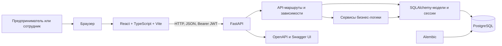

# Архитектура Smart Credit Cabinet

## Назначение и границы системы

Smart Credit Cabinet — веб-приложение для предпринимателей и сотрудников банка. Пользователь может просматривать кредитные продукты, рассчитывать платежи, вести профиль бизнеса, получать рекомендации и подавать заявки. Сотрудник просматривает заявки и меняет их статус.

Решения по заявкам демонстрационные: приложение не подключено к банковским или государственным системам, не перечисляет деньги и не выполняет реальный банковский скоринг.

## Технологии

| Часть | Реализация |
|---|---|
| Веб-клиент | React 19, TypeScript, Vite, React Router |
| HTTP-клиент | Axios; адрес API задаётся `VITE_API_BASE_URL`, по умолчанию `http://127.0.0.1:8000/api/v1` |
| Backend | Python, FastAPI, Pydantic |
| Хранение данных | PostgreSQL, SQLAlchemy |
| Миграции | Alembic |
| Авторизация | JWT bearer-токены; пароли хешируются Argon2 через `pwdlib` |
| Тесты backend | pytest; тестовая конфигурация использует SQLite и совместимый тип JSON |
| Запуск | Docker Compose для PostgreSQL, backend и Vite frontend |

## Схема компонентов

Frontend и backend — отдельные приложения. Backend публикует API под `/api/v1`; документация FastAPI доступна по `/docs`, схема — по `/openapi.json`. CORS-разрешённые адреса frontend и строка подключения к базе задаются конфигурацией backend через переменные окружения.

## Backend

`backend/app/main.py` создаёт приложение FastAPI, настраивает CORS, подключает маршрутизаторы и публикует `/` и `/health`.

| Пакет | Ответственность |
|---|---|
| `app/api/` | HTTP-маршруты: авторизация, заявки, продукты, калькулятор, профиль бизнеса и рекомендации |
| `app/schemas/` | Pydantic-модели запросов и ответов, валидация данных |
| `app/models/` | SQLAlchemy-модели семи таблиц |
| `app/services/` | Аутентификация, расчёт кредита, обработка заявок, история статусов, подбор рекомендаций |
| `app/core/` | Настройки, движок и сессии БД, JWT/хеширование паролей, общий тип JSON/JSONB |
| `alembic/` | Версионируемые изменения схемы БД |
| `scripts/` | Вспомогательные команды, в том числе загрузка демонстрационных продуктов |
| `tests/` | Тесты API, сервисов и моделей |

FastAPI-маршруты получают SQLAlchemy-сессию через зависимость `get_db`. Аутентификация использует bearer-токен; зависимости текущего пользователя и сотрудника проверяют пользователя и роли. Роли `staff` и `admin` допускаются к операциям сотрудников.

Вычисления кредита используют аннуитетную схему и `Decimal`. Сервис расчёта не включает комиссию; API-калькулятор отдельно добавляет комиссию продукта к общей выплате и переплате. При отправке заявки сервис обработки рассчитывает платежи и предварительную оценку долговой нагрузки. Эти значения не заменяют решение сотрудника.

## Frontend

Точка входа — `frontend/src/main.tsx`; приложение подключает маршрутизатор и `AuthProvider`. Маршруты собраны в `frontend/src/app/router.tsx`: публичные страницы входа/регистрации, защищённые страницы кабинета и отдельный маршрут сотрудника. UI-защита маршрутов нужна для интерфейса, а проверка доступа к защищённым API выполняется backend.

Клиент Axios и его перехватчики находятся в `frontend/src/services/apiClients.ts`: токен хранится в `localStorage`, прикрепляется к запросам и удаляется при ответе `401`. Вызовы API сгруппированы по возможностям в `features/` и страницах `pages/`.

## Данные и согласованность

Реляционная схема включает пользователей, продукты, заявки, профили бизнеса, историю статусов и сохранённые рекомендации. PostgreSQL использует JSONB для полей со списками; общий тип SQLAlchemy подменяет его на JSON в SQLite.

При создании заявки backend требует профиль бизнеса и указанную в нём выручку. Значение выручки записывается в `monthly_income` заявки. Создание заявки и переходы между статусами дополнительно записываются в `application_history`.

Подробнее: [модель данных](./data-model.md), [состояния заявки](./application-states.md), [API](./api.md).

## Запуск и конфигурация

Docker Compose определяет PostgreSQL, backend и Vite frontend. При старте backend-контейнер сначала применяет миграции Alembic, затем запускает `python -m app.seed` для загрузки синтетических пользователей, кредитных продуктов, профилей бизнеса и заявок, после чего запускает Uvicorn. Ошибка миграции или загрузки данных останавливает запуск API. Seed рассчитан на локальную демонстрационную среду и не предназначен для production.

Для локального запуска и настройки переменных окружения см. [инструкцию по запуску](../README-setup.md). Секрет JWT, URL базы данных и CORS-источники должны задаваться конфигурацией окружения, а не храниться в исходном коде.
