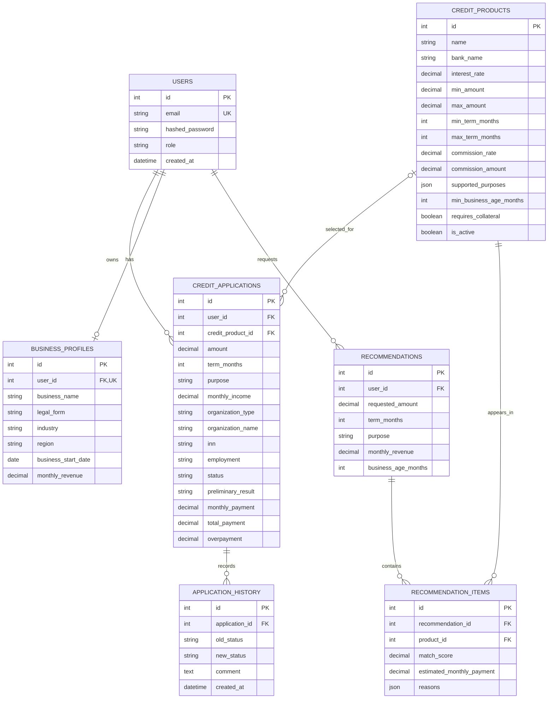

# Модель данных Smart Credit Cabinet

## Обзор

Основная БД — PostgreSQL, доступ к ней реализован через SQLAlchemy, изменения схемы — через Alembic. В приложении семь таблиц. Денежные значения хранятся в `NUMERIC`; поля со списками используют JSONB в PostgreSQL и тип JSON при тестировании на SQLite.

## ER-диаграмма

## Таблицы

### `users`

- `id` — первичный ключ.
- `email` — уникальный email пользователя.
- `hashed_password` — хеш пароля.
- `role` — роль, по умолчанию `client`; API проверяет роли `staff` и `admin` для операций сотрудников.
- `created_at` — время создания.

Связи: пользователь имеет заявки и не более одного профиля бизнеса. Рекомендации ссылаются на пользователя через `user_id`.

### `credit_products`

- `id`, `name`, `bank_name`.
- `interest_rate` — ставка продукта.
- `min_amount`, `max_amount`, `min_term_months`, `max_term_months` — диапазоны условий.
- `commission_rate`, `commission_amount` — необязательные варианты комиссии.
- `additional_conditions`, `description` — текстовые условия и описание.
- `supported_purposes` — список поддерживаемых целей, JSON/JSONB.
- `min_business_age_months` — минимальный возраст бизнеса, если задан.
- `requires_collateral`, `is_active` — залог и доступность продукта.
- `created_at`, `updated_at`.

Неактивные продукты не возвращаются публичным каталогом, калькулятором и подбором.

### `credit_applications`

- `id`, `user_id`, `credit_product_id`.
- `amount`, `term_months`, `purpose` — параметры заявки.
- `monthly_income` — доход, используемый для предварительной оценки.
- `organization_type`, `organization_name`, `inn` — данные организации, допускающие `NULL`.
- `employment` — устаревшее поле, оставленное для совместимости.
- `status` — текущий статус, по умолчанию `draft`.
- `comment`, `decision_comment` — комментарий и комментарий решения.
- `preliminary_result` — предварительная оценка нагрузки.
- `monthly_payment`, `total_payment`, `overpayment` — рассчитанные платежи.
- `created_at`, `updated_at`.

`user_id` обязателен и ссылается на `users` с `ON DELETE CASCADE`. `credit_product_id` допускает `NULL` и при удалении продукта сбрасывается (`ON DELETE SET NULL`). При создании через API продукт обязателен, активен и должен подходить по сумме и сроку.

### `application_history`

- `id`, `application_id`, `old_status`, `new_status`, `comment`, `created_at`.

Запись создаётся при создании заявки и каждом реализованном переходе статуса. `old_status` равен `NULL` для первоначального события. История удаляется вместе с заявкой (`ON DELETE CASCADE`).

### `business_profiles`

- `id`, `user_id`, `business_name`, `legal_form`.
- `industry`, `region`, `business_start_date`, `monthly_revenue`.
- `created_at`, `updated_at`.

На пользователя допускается один профиль: `user_id` уникален. Профиль удаляется вместе с пользователем. Для создания заявки API требует профиль с указанной выручкой и копирует её в `credit_applications.monthly_income`.

### `recommendations`

- `id`, `user_id`.
- `requested_amount`, `term_months`, `purpose`.
- `monthly_revenue`, `business_age_months`.
- `created_at`.

Содержит параметры сохранённого подбора. API выдаёт сохранённую рекомендацию только её владельцу.

### `recommendation_items`

- `id`, `recommendation_id`, `product_id`.
- `match_score`, `estimated_monthly_payment`, `reasons`, `created_at`.

Одна запись представляет подходящий продукт с оценкой и причинами. Элементы удаляются вместе с рекомендацией; ссылка на продукт также каскадно удаляет элемент.

## Правила подбора и заявки

- Подбор рассматривает только активные продукты и исключает неподходящие сумму, срок, цель и минимальный возраст бизнеса.
- `match_score` складывается из суммы (40%), срока (30%), дохода (20%) и возраста бизнеса (10%); элементы сортируются по убыванию оценки.
- Если доход не указан или неположительный, оценка соответствия дохода частичная (0.5). При этом создание кредитной заявки требует указать выручку в профиле.
- Предварительная оценка заявки сравнивает платёж с `monthly_income`: до 40% включительно — `likely_eligible`, выше 40% — `high_debt_burden`. Это не окончательное решение банка.
- Расчёт и оценка используют денежную арифметику `Decimal`. Расчётный сервис считает аннуитетный платёж без комиссии; калькулятор API добавляет комиссию продукта к общей выплате.

## Изменения схемы

История изменений схемы находится в `backend/alembic/versions/`. При запуске backend-контейнера Docker миграции `alembic upgrade head` выполняются автоматически перед загрузкой синтетических данных из `app.seed` и запуском Uvicorn. Для локального запуска применяйте миграции командой `alembic upgrade head` из каталога `backend` до запуска seed-скрипта.
