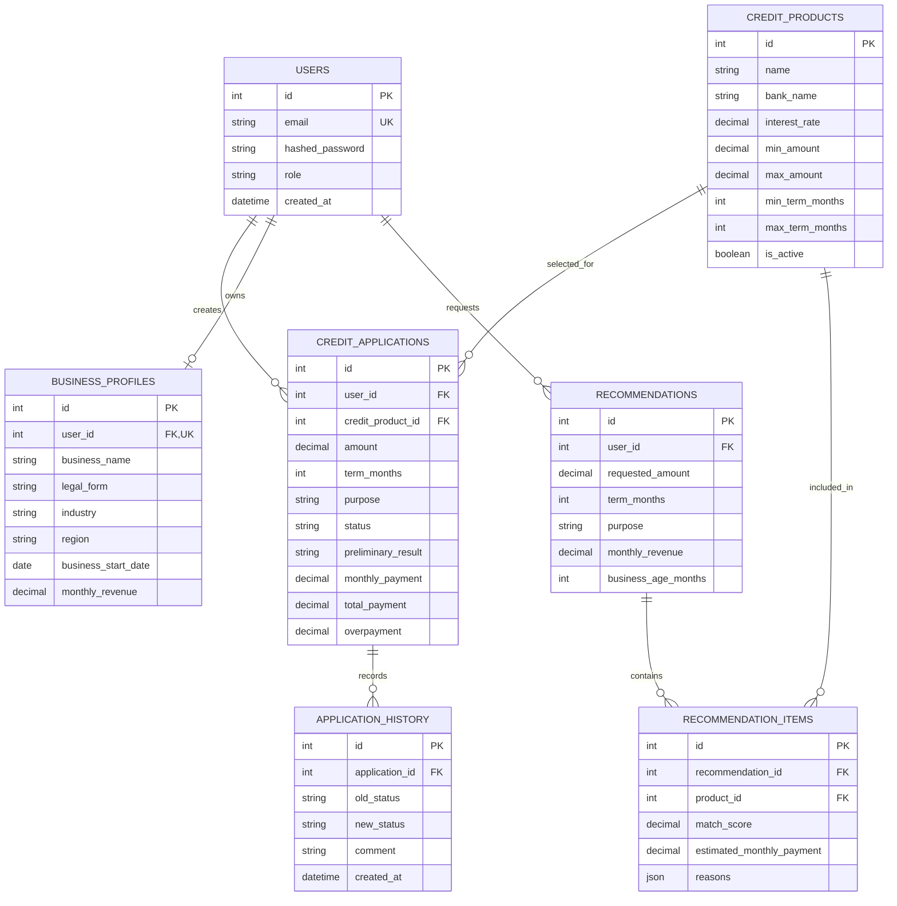

# Модель данных — Smart Credit Cabinet

СУБД: PostgreSQL. ORM: SQLAlchemy. Миграции: Alembic. По предоставленному описанию используются семь таблиц.

## 1. ER-диаграмма

## 2. Таблицы

### `users`
- `id` — первичный ключ;
- `email` — уникальный email;
- `hashed_password` — хеш пароля Argon2;
- `role` — роль `client`, `staff` или `admin`;
- `created_at` — дата создания.

Связи: пользователь имеет заявки, один профиль бизнеса и сохранённые рекомендации.

### `credit_products`
- `id`, `name`, `bank_name`;
- `interest_rate` — годовая процентная ставка;
- `min_amount`, `max_amount` — границы суммы;
- `min_term_months`, `max_term_months` — границы срока;
- `commission_rate`, `commission_amount` — возможные комиссии;
- `description`, `additional_conditions`;
- `supported_purposes` — список целей в JSON/JSONB;
- `min_business_age_months`, `requires_collateral`, `is_active`;
- `created_at`, `updated_at`.

### `credit_applications`
- `id`, `user_id`, `credit_product_id`;
- `amount`, `term_months`, `purpose`;
- `monthly_income`, `employment`;
- `status`, `comment`, `decision_comment`;
- `preliminary_result`;
- `monthly_payment`, `total_payment`, `overpayment`;
- `created_at`, `updated_at`.

`credit_product_id` допускает `NULL` согласно предоставленной модели.

### `application_history`
- `id`, `application_id`;
- `old_status`, `new_status`, `comment`, `created_at`.

Хранит историю переходов. При первоначальном создании `old_status` может быть `NULL`.

### `business_profiles`
- `id`, `user_id`;
- `business_name`, `legal_form`, `industry`, `region`;
- `business_start_date`, `monthly_revenue`;
- `created_at`, `updated_at`.

`user_id` уникален: один профиль на пользователя.

### `recommendations`
- `id`, `user_id`;
- `requested_amount`, `term_months`, `purpose`;
- `monthly_revenue`, `business_age_months`, `created_at`.

### `recommendation_items`
- `id`, `recommendation_id`, `product_id`;
- `match_score`, `estimated_monthly_payment`, `reasons`, `created_at`.

Хранит отдельные продукты в сохранённом подборе и причины соответствия.

## 3. Бизнес-правила и ограничения

- Email уникален.
- Денежные поля хранятся в `NUMERIC`, а не в двоичном `float`.
- Продукт для заявки должен существовать и быть активным.
- Пользователь должен иметь доступ только к своим заявкам, профилю и рекомендациям.
- `approved` и `rejected` — финальные статусы по описанию проекта.
- `likely_eligible` и `high_debt_burden` — предварительная оценка нагрузки, не банковское решение.
- Для рекомендаций описана взвешенная оценка `match_score`: сумма 40%, срок 30%, доход 20%, возраст бизнеса 10%; неподходящие продукты отфильтровываются.

## 4. Миграции

В предоставленном описании указано 12 миграций. Список ревизий следует проверять по фактическим файлам `backend/alembic/versions/`; имена ревизий здесь не дублируются, чтобы избежать расхождения при изменениях.
